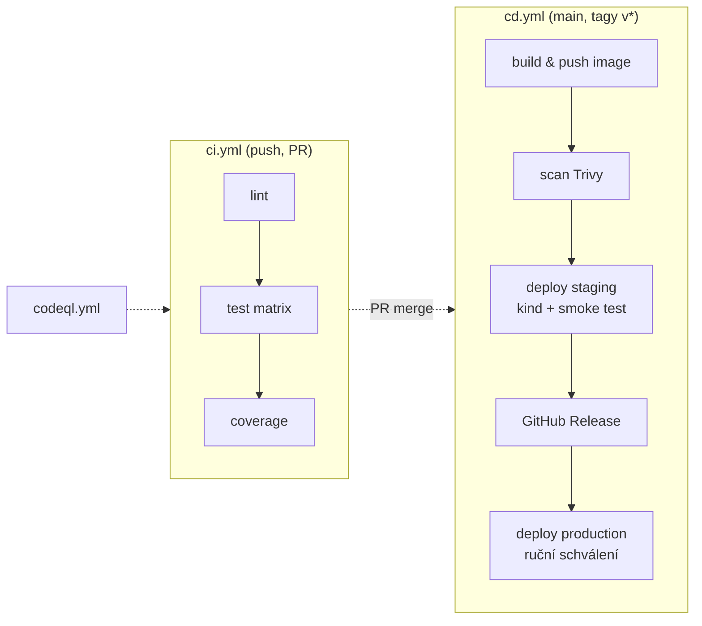
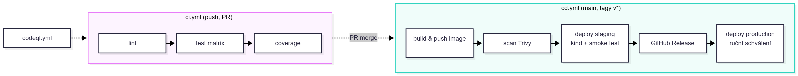

## Cvičení: CI/CD pipeline s GitHub Actions

### Úvod

Studenti dostanou malou webovou službu **TodoApi** (REST API v .NET 8, minimal API). Během cvičení k ní postupně postaví kompletní **CI/CD pipeline**. Ta po každé změně kódu automaticky:

1. zkontroluje formátování a styl kódu,
2. sestaví aplikaci a spustí testy na více platformách,
3. vyhodnotí pokrytí kódu testy,
4. zablokuje merge, když něco selže,
5. sestaví Docker image a publikuje ho do registry,
6. prověří image i závislosti kvůli zranitelnostem,
7. nasadí aplikaci do Kubernetes clusteru (staging) a ověří, že funguje,
8. po vytvoření verze (`v1.0.0`) vytvoří release a po ručním schválení nasadí do produkce.

Šablona repozitáře obsahuje **záměrné chyby**: padající test, porušené formátování a zranitelnou závislost. Studenti je odhalí právě pomocí pipeline.

**Výsledná pipeline:**




**Předpoklady:** GitHub účet, Git, Docker, .NET 8 SDK, VS Code nebo Rider (lokálně volitelně `kind` a `kubectl`).

---

### Struktura šablony repozitáře

```text
todo-api/
├── src/TodoApi/
│   ├── Program.cs
│   ├── TodoApi.csproj
│   └── packages.lock.json
├── tests/TodoApi.Tests/
│   ├── TodoEndpointsTests.cs
│   └── TodoApi.Tests.csproj
├── k8s/
│   ├── deployment.yaml
│   └── service.yaml
├── Dockerfile
├── .editorconfig
├── TodoApi.sln
└── README.md
```

**`src/TodoApi/Program.cs`** (zkráceno):
```csharp
var builder = WebApplication.CreateBuilder(args);
builder.Services.AddSingleton<TodoStore>();
var app = builder.Build();

app.MapGet("/health", () => Results.Ok(new { status = "ok", version = AppInfo.Version }));
app.MapGet("/api/todos", (TodoStore s) => s.GetAll());
app.MapPost("/api/todos", (TodoStore s, TodoItem item) =>
{
    if (string.IsNullOrWhiteSpace(item.Title))
        return Results.BadRequest("Title is required");
    var created = s.Add(item);
    return Results.Created($"/api/todos/{created.Id}", created);
});

app.Run();

public partial class Program { }   // kvůli WebApplicationFactory v testech
```

**Záměrné chyby v šabloně (pro vyučujícího):**

| Chyba | Kde | Odhalí ji |
|---|---|---|
| Test očekává `200`, API vrací `201 Created` | `TodoEndpointsTests.cs` | úkol 2 |
| Špatné odsazení a chybějící `{}` u `if` (porušení `.editorconfig`) | `TodoStore.cs` | úkol 3 |
| `Newtonsoft.Json` 12.0.3 (známá zranitelnost, opraveno ve 13.0.1) | `TodoApi.csproj` | úkol 9 |
| `/health` vrací chybu, pokud chybí proměnná `APP_VERSION` | `AppInfo.cs` | úkol 11 |

---

## Úkoly

### Úkol 1: Příprava repozitáře a lokální ověření (1 b)

**Cíl:** Zprovoznit projekt lokálně. Pipeline má automatizovat jen to, co umíme spustit ručně.

**Zadání:**
1. Vytvořte si vlastní repozitář a vložte připravený kód
2. Spusťte lokálně:
   ```bash
   dotnet restore
   dotnet build
   dotnet test        # jeden test spadne, to je v pořádku
   dotnet run --project src/TodoApi
   curl http://localhost:5000/health
   ```
3. Sestavte a spusťte Docker image:
   ```bash
   docker build -t todo-api:local .
   docker run --rm -p 8080:8080 -e APP_VERSION=dev todo-api:local
   curl http://localhost:8080/health
   ```
4. Prostudujte `Dockerfile` a v `README.md` vysvětlete, proč je multi-stage:
   ```dockerfile
   FROM mcr.microsoft.com/dotnet/sdk:8.0 AS build
   WORKDIR /src
   COPY src/TodoApi/*.csproj src/TodoApi/
   RUN dotnet restore src/TodoApi
   COPY . .
   RUN dotnet publish src/TodoApi -c Release -o /app --no-restore

   FROM mcr.microsoft.com/dotnet/aspnet:8.0
   WORKDIR /app
   COPY --from=build /app .
   USER app
   EXPOSE 8080
   ENTRYPOINT ["dotnet", "TodoApi.dll"]
   ```

**Splněno, když:** aplikace běží lokálně i v kontejneru a `README.md` obsahuje odpověď na otázku.

> 💡 Proč se `*.csproj` kopíruje zvlášť před `COPY . .`? Vrstva s `restore` se díky tomu cachuje a při změně kódu se nestahují znovu všechny balíčky.

---

### Úkol 2: První CI workflow (2 b)

**Cíl:** Při každém `push` a `pull_request` se kód automaticky sestaví a otestuje.

**Zadání:**
1. Vytvořte `.github/workflows/ci.yml`.
2. Workflow se spouští na `push` do `main` a na každý `pull_request`.
3. Kroky: checkout → instalace .NET → restore → build → test.
4. Commitněte a podívejte se do záložky **Actions**: build bude **červený**.
5. Z logu zjistěte, který test padá a proč. Opravte **test, ne aplikaci** (`201 Created` je pro POST správná odpověď).
6. Pushněte opravu a ověřte zelený build.

**Ukázka:**
```yaml
name: CI

on:
  push:
    branches: [main]
  pull_request:

permissions:
  contents: read

jobs:
  test:
    runs-on: ubuntu-latest
    timeout-minutes: 10
    steps:
      - uses: actions/checkout@v4

      - uses: actions/setup-dotnet@v4
        with:
          dotnet-version: '8.0.x'

      - name: Restore
        run: dotnet restore

      - name: Build
        run: dotnet build --no-restore -c Release

      - name: Test
        run: dotnet test --no-build -c Release --verbosity normal
```

**Oprava testu:**
```csharp
[Fact]
public async Task Post_ValidTodo_ReturnsCreated()
{
    var response = await _client.PostAsJsonAsync("/api/todos", new { title = "Napsat CI" });

    Assert.Equal(HttpStatusCode.Created, response.StatusCode);   // bylo: OK
    Assert.NotNull(response.Headers.Location);
}
```

**Splněno, když:** v historii Actions je jeden červený a následně zelený běh.

> 💡 Proč `--no-restore` a `--no-build`? Každý krok dělá jen svou práci, takže je log přehledný a pipeline rychlejší.
> 💡 `permissions: contents: read` je princip nejmenších oprávnění. Výchozí `GITHUB_TOKEN` může mít zbytečně široká práva.

---

### Úkol 3: Kontrola formátování a závislosti jobů (1 b)

**Cíl:** Styl kódu kontroluje stroj, ne reviewer. Rychlé kontroly běží první (*fail fast*).

**Zadání:**
1. Přidejte job `lint`, který spustí `dotnet format --verify-no-changes`.
2. Job `test` poběží až po úspěšném `lint` (`needs:`).
3. Build selže. Lokálně spusťte `dotnet format`, prohlédněte si diff (`git diff`) a commitněte.
4. Do `.editorconfig` přidejte pravidlo, které vynutí složené závorky, a nastavte ho jako chybu:
   ```ini
   [*.cs]
   csharp_prefer_braces = true:error
   dotnet_diagnostic.IDE0011.severity = error
   ```

**Ukázka:**
```yaml
jobs:
  lint:
    runs-on: ubuntu-latest
    steps:
      - uses: actions/checkout@v4
      - uses: actions/setup-dotnet@v4
        with:
          dotnet-version: '8.0.x'
      - run: dotnet format --verify-no-changes --verbosity diagnostic

  test:
    needs: lint
    # ...
```

**Splněno, když:** pipeline má dva joby v sérii a v grafu běhu je vidět závislost.

> 💡 Bonus: přidejte pre-commit hook (`.git/hooks/pre-commit` nebo nástroj Husky.Net), aby chyba neodešla ani lokálně. Diskuse: proč CI kontrola i tak zůstává?

---

### Úkol 4: Cache a matrix build (2 b)

**Cíl:** Zrychlit pipeline a otestovat aplikaci ve více prostředích.

**Zadání:**
1. Zapněte lock soubor závislostí v obou `.csproj`:
   ```xml
   <PropertyGroup>
     <RestorePackagesWithLockFile>true</RestorePackagesWithLockFile>
   </PropertyGroup>
   ```
   a commitněte vygenerované `packages.lock.json`.
2. Zapněte cache NuGet balíčků v `setup-dotnet`.
3. Spusťte `restore` s `--locked-mode`, aby build selhal, pokud lock soubor neodpovídá.
4. Přidejte matrix: OS `ubuntu-latest`, `windows-latest` × .NET `8.0.x`, `9.0.x`.
5. **Změřte** dobu kroku Restore bez cache a s cache (první a druhý běh) a zapište ji do `CICD.md`.
6. Nastavte `fail-fast: false` a vysvětlete, co to mění.

**Ukázka:**
```yaml
  test:
    needs: lint
    runs-on: ${{ matrix.os }}
    strategy:
      fail-fast: false
      matrix:
        os: [ubuntu-latest, windows-latest]
        dotnet: ['8.0.x', '9.0.x']
    steps:
      - uses: actions/checkout@v4
      - uses: actions/setup-dotnet@v4
        with:
          dotnet-version: ${{ matrix.dotnet }}
          cache: true
          cache-dependency-path: '**/packages.lock.json'
      - run: dotnet restore --locked-mode
      - run: dotnet build --no-restore -c Release
      - run: dotnet test --no-build -c Release
```

**Splněno, když:** běží 4 paralelní joby a `CICD.md` obsahuje naměřené časy.

> 💡 Proč lock soubor? Bez něj se může `1.2.*` jednou vyhodnotit na `1.2.3` a podruhé na `1.2.4`, takže build není reprodukovatelný.
> ⚠️ Projekt cílí na `net8.0`. Na .NET 9 SDK se přesto sestaví, protože SDK je zpětně kompatibilní. Diskuse: co přesně tedy matrix testuje?

---

### Úkol 5: Výsledky testů, code coverage a artefakty (2 b)

**Cíl:** Výsledky testů jsou čitelné bez procházení logu a pokrytí kódu je hlídané.

**Zadání:**
1. Testy budou generovat `trx` report a coverage ve formátu Cobertura.
2. Výsledky nahrajte jako **artefakt** (i když testy selžou, tedy `if: always()`).
3. Vytvořte samostatný job `coverage` (jen Ubuntu, .NET 8), který:
   - vygeneruje HTML report (ReportGenerator) a nahraje ho jako artefakt,
   - zapíše souhrn do **Job Summary** (`$GITHUB_STEP_SUMMARY`),
   - **selže, pokud pokrytí klesne pod 70 %**.
4. Ověřte práh: zakomentujte jeden test a sledujte, zda pipeline spadne.

**Ukázka:**
```yaml
  coverage:
    needs: lint
    runs-on: ubuntu-latest
    steps:
      - uses: actions/checkout@v4
      - uses: actions/setup-dotnet@v4
        with:
          dotnet-version: '8.0.x'

      - name: Test with coverage
        run: |
          dotnet test -c Release \
            --collect:"XPlat Code Coverage" \
            --logger "trx;LogFileName=results.trx" \
            --results-directory ./TestResults

      - name: Coverage report
        uses: danielpalme/ReportGenerator-GitHub-Action@5
        with:
          reports: 'TestResults/**/coverage.cobertura.xml'
          targetdir: 'coverage-report'
          reporttypes: 'HtmlInline;MarkdownSummaryGithub;TextSummary'

      - name: Job summary
        run: cat coverage-report/SummaryGithub.md >> $GITHUB_STEP_SUMMARY

      - name: Enforce threshold (70 %)
        run: |
          LINE=$(grep -oP 'Line coverage: \K[0-9.]+' coverage-report/Summary.txt)
          echo "Line coverage: $LINE %"
          awk -v c="$LINE" 'BEGIN { exit (c < 70) }' || { echo "::error::Coverage $LINE % < 70 %"; exit 1; }

      - uses: actions/upload-artifact@v4
        if: always()
        with:
          name: coverage-and-tests
          path: |
            coverage-report/
            TestResults/**/*.trx
          retention-days: 7
```

**Splněno, když:** v souhrnu běhu je tabulka pokrytí, artefakt lze stáhnout a při poklesu pod práh pipeline selže.

> 💡 `::error::` je *workflow command*: chyba se zobrazí přímo v UI běhu. Vyzkoušejte i `::warning file=src/TodoApi/Program.cs,line=5::text`.

---

### Úkol 6: Ochrana větve a pull request workflow (2 b)

**Cíl:** Do `main` se nedostane nic, co neprošlo CI a review.

**Zadání:**
1. *Settings → Rules → Rulesets → New branch ruleset* pro `main`:
   - ✅ Require a pull request before merging (1 approval)
   - ✅ Require status checks to pass: `lint`, `coverage` a všechny joby `test (...)`
   - ✅ Block force pushes
   - ✅ Require linear history (volitelné)
2. Zkuste `git push` přímo do `main`. Musí selhat.
3. Vytvořte větev `feature/delete-todo` a implementujte `DELETE /api/todos/{id}` **bez testu**, aby kleslo pokrytí.
4. Otevřete PR a ověřte, že je merge zablokovaný. Doplňte test a ověřte, že se merge odemkne.
5. Požádejte spolužáka o review (nebo pro účely cvičení přidejte vyučujícího jako collaboratora).
6. Přidejte `concurrency`, aby nový push do PR zrušil starý běh:
   ```yaml
   concurrency:
     group: ${{ github.workflow }}-${{ github.ref }}
     cancel-in-progress: true
   ```

**Ukázka nového endpointu a testu:**
```csharp
app.MapDelete("/api/todos/{id:int}", (TodoStore s, int id) =>
    s.Remove(id) ? Results.NoContent() : Results.NotFound());
```
```csharp
[Fact]
public async Task Delete_NonExisting_ReturnsNotFound()
{
    var response = await _client.DeleteAsync("/api/todos/9999");
    Assert.Equal(HttpStatusCode.NotFound, response.StatusCode);
}
```

**Splněno, když:** screenshot zablokovaného PR a následně úspěšně mergnutý PR se zelenými checky.

> ⚠️ Status check jde vybrat až poté, co alespoň jednou proběhl. Nastavujte ruleset až po úkolu 5.
> 💡 Diskuse: proč workflow spuštěné z PR z **forku** nemá přístup k secrets? (Útočník by mohl upravit workflow a secrets vypsat.)

---

### Úkol 7: Build a publikace Docker image do GHCR (2 b)

**Cíl:** Každá změna v `main` vytvoří verzovaný image v GitHub Container Registry.

**Zadání:**
1. Vytvořte `.github/workflows/cd.yml` se spouštěčem `push` na `main` a na tagy `v*.*.*`.
2. Přihlaste se do `ghcr.io` pomocí `GITHUB_TOKEN` (žádný osobní token).
3. Pomocí `docker/metadata-action` generujte tagy:
   - `sha-<7 znaků>` vždy,
   - `1.2.0`, `1.2` při tagu `v1.2.0`,
   - `main` pro větev main.
4. Při buildu předejte verzi aplikace (`APP_VERSION`) jako build argument a doplňte ho do `Dockerfile`.
5. Zapněte cache Docker vrstev (`type=gha`).
6. Ověřte, že se image objevil v sekci **Packages** repozitáře, stáhněte ho lokálně a spusťte.

**Ukázka:**
```yaml
name: CD

on:
  push:
    branches: [main]
    tags: ['v*.*.*']

permissions:
  contents: read
  packages: write

jobs:
  image:
    runs-on: ubuntu-latest
    outputs:
      image: ${{ steps.vars.outputs.image }}
    steps:
      - uses: actions/checkout@v4

      - id: vars
        run: |
          IMAGE="ghcr.io/${GITHUB_REPOSITORY,,}"
          echo "image=${IMAGE}:sha-${GITHUB_SHA::7}" >> "$GITHUB_OUTPUT"

      - uses: docker/setup-buildx-action@v3

      - uses: docker/login-action@v3
        with:
          registry: ghcr.io
          username: ${{ github.actor }}
          password: ${{ secrets.GITHUB_TOKEN }}

      - id: meta
        uses: docker/metadata-action@v5
        with:
          images: ghcr.io/${{ github.repository }}
          tags: |
            type=sha
            type=ref,event=branch
            type=semver,pattern={{version}}
            type=semver,pattern={{major}}.{{minor}}

      - uses: docker/build-push-action@v6
        with:
          context: .
          push: true
          tags: ${{ steps.meta.outputs.tags }}
          labels: ${{ steps.meta.outputs.labels }}
          build-args: APP_VERSION=${{ steps.meta.outputs.version }}
          cache-from: type=gha
          cache-to: type=gha,mode=max
```

**Úprava `Dockerfile`:**
```dockerfile
FROM mcr.microsoft.com/dotnet/aspnet:8.0
ARG APP_VERSION=dev
ENV APP_VERSION=${APP_VERSION}
# ...
```

**Splněno, když:** v Packages jsou alespoň dva image s různými `sha-` tagy a `docker run` vrací na `/health` správnou verzi.

> 💡 `${GITHUB_REPOSITORY,,}` je bash převod na malá písmena. Registry nepovolují velká písmena, takže `Novak/Todo-API` by selhalo.
> 💡 Diskuse: proč nepoužívat tag `latest` pro nasazení? (Není jasné, co přesně běží, a rollback není deterministický.)

---

### Úkol 8: Bezpečnost: Dependabot, CodeQL, Trivy (2 b)

**Cíl:** Zranitelnosti v závislostech, kódu a image se odhalí automaticky.

**Zadání:**
1. **Dependabot:** vytvořte `.github/dependabot.yml` pro ekosystémy `nuget`, `github-actions` a `docker`.
   - Počkejte na PR, který povýší `Newtonsoft.Json`, a nechte ho projít CI a mergněte ho.
   - Zjistěte, zda balíček aplikace vůbec používá. Pokud ne, odstraňte ho úplně, což je lepší řešení.
2. **CodeQL:** přidejte workflow `codeql.yml` (na PR, `main` a jednou týdně přes `schedule`).
3. **Trivy:** v `cd.yml` přidejte job `scan`, který prověří publikovaný image a **selže při CRITICAL zranitelnosti**.
4. Do `CICD.md` zapište, které nálezy se objevily a jak jste je řešili.

**`.github/dependabot.yml`:**
```yaml
version: 2
updates:
  - package-ecosystem: nuget
    directory: /
    schedule:
      interval: weekly
    groups:
      test-dependencies:
        patterns: ["xunit*", "Microsoft.NET.Test.Sdk", "coverlet*"]

  - package-ecosystem: github-actions
    directory: /
    schedule:
      interval: weekly

  - package-ecosystem: docker
    directory: /
    schedule:
      interval: weekly
```

**`.github/workflows/codeql.yml`:**
```yaml
name: CodeQL

on:
  push:
    branches: [main]
  pull_request:
  schedule:
    - cron: '0 6 * * 1'   # pondělí 6:00 UTC

permissions:
  security-events: write
  contents: read

jobs:
  analyze:
    runs-on: ubuntu-latest
    steps:
      - uses: actions/checkout@v4
      - uses: github/codeql-action/init@v3
        with:
          languages: csharp
          build-mode: none
      - uses: github/codeql-action/analyze@v3
```

**Job `scan` v `cd.yml`:**
```yaml
  scan:
    needs: image
    runs-on: ubuntu-latest
    permissions:
      packages: read
    steps:
      - uses: docker/login-action@v3
        with:
          registry: ghcr.io
          username: ${{ github.actor }}
          password: ${{ secrets.GITHUB_TOKEN }}

      - name: Trivy scan
        run: |
          docker run --rm \
            -v /var/run/docker.sock:/var/run/docker.sock \
            aquasec/trivy:latest image \
            --severity CRITICAL,HIGH \
            --exit-code 1 \
            --ignore-unfixed \
            ${{ needs.image.outputs.image }}
```

**Splněno, když:** existuje mergnutý Dependabot PR, CodeQL běží a výsledky jsou v *Security → Code scanning*, job `scan` je součástí CD.

> ⚠️ **Supply chain:** akce třetích stran (`uses: neco/akce@v1`) jsou cizí kód s přístupem k vašemu tokenu. V produkci je **pinujte na commit SHA**:
> ```yaml
> - uses: actions/checkout@<plný 40znakový SHA>   # v4.x.x
> ```
> Úkol: najděte reálný incident kompromitované GitHub Action a stručně ho popište v `CICD.md`.

---

### Úkol 9: Nasazení do Kubernetes (staging) se smoke testem (3 b)

**Cíl:** Pipeline image skutečně nasadí a ověří, že aplikace v clusteru funguje. Jako dočasný cluster poslouží **kind** přímo na runneru.

**Zadání:**
1. Doplňte manifesty v `k8s/` o **readiness a liveness probe** na `/health` a o proměnnou `APP_VERSION`.
2. V GitHubu vytvořte environment **`staging`** (*Settings → Environments*) a přidejte do něj proměnnou `REPLICAS=2`.
3. Job `deploy-staging` (`needs: scan`, `environment: staging`):
   - vytvoří kind cluster,
   - stáhne image z GHCR a nahraje ho do kind (`kind load`), takže není nutný pull secret,
   - aplikuje manifesty a nastaví image,
   - počká na `rollout status`,
   - spustí **smoke test**: `/health` vrací 200 a správnou verzi, POST a GET `/api/todos` fungují,
   - při selhání vypíše diagnostiku (`describe`, `logs`).
4. Odhalte záměrnou chybu: bez `APP_VERSION` aplikace na `/health` padá, takže readiness probe nikdy neprojde. Opravte ji v manifestu nebo v kódu (fallback na `"unknown"`) a zdůvodněte svou volbu.

**`k8s/deployment.yaml`:**
```yaml
apiVersion: apps/v1
kind: Deployment
metadata:
  name: todo-api
spec:
  replicas: 2
  selector:
    matchLabels: { app: todo-api }
  template:
    metadata:
      labels: { app: todo-api }
    spec:
      containers:
        - name: api
          image: todo-api:placeholder
          ports:
            - containerPort: 8080
          env:
            - name: APP_VERSION
              value: "placeholder"
          readinessProbe:
            httpGet: { path: /health, port: 8080 }
            initialDelaySeconds: 3
            periodSeconds: 5
          livenessProbe:
            httpGet: { path: /health, port: 8080 }
            initialDelaySeconds: 10
            periodSeconds: 10
          resources:
            requests: { cpu: 50m, memory: 64Mi }
            limits: { memory: 256Mi }
```

**`k8s/service.yaml`:**
```yaml
apiVersion: v1
kind: Service
metadata:
  name: todo-api
spec:
  selector: { app: todo-api }
  ports:
    - port: 80
      targetPort: 8080
```

**Job v `cd.yml`:**
```yaml
  deploy-staging:
    needs: [image, scan]
    runs-on: ubuntu-latest
    environment:
      name: staging
    permissions:
      packages: read
    env:
      IMAGE: ${{ needs.image.outputs.image }}
    steps:
      - uses: actions/checkout@v4

      - uses: helm/kind-action@v1
        with:
          cluster_name: staging

      - uses: docker/login-action@v3
        with:
          registry: ghcr.io
          username: ${{ github.actor }}
          password: ${{ secrets.GITHUB_TOKEN }}

      - name: Load image into kind
        run: |
          docker pull "$IMAGE"
          kind load docker-image "$IMAGE" --name staging

      - name: Deploy
        run: |
          kubectl apply -f k8s/
          kubectl set image deployment/todo-api api="$IMAGE"
          kubectl set env deployment/todo-api APP_VERSION="${IMAGE##*:}"
          kubectl scale deployment/todo-api --replicas=${{ vars.REPLICAS }}
          kubectl rollout status deployment/todo-api --timeout=120s

      - name: Smoke test
        run: |
          kubectl port-forward svc/todo-api 8080:80 &
          sleep 3
          set -e
          curl -fsS http://localhost:8080/health | tee health.json
          grep -q "${IMAGE##*:}" health.json
          curl -fsS -X POST http://localhost:8080/api/todos \
               -H 'Content-Type: application/json' -d '{"title":"smoke"}'
          curl -fsS http://localhost:8080/api/todos | grep -q smoke
          echo "✅ Smoke test passed" >> $GITHUB_STEP_SUMMARY

      - name: Diagnostics on failure
        if: failure()
        run: |
          kubectl get pods -o wide
          kubectl describe deployment/todo-api
          kubectl logs -l app=todo-api --tail=50
```

**Splněno, když:** v záložce *Deployments* je vidět nasazení do `staging` a smoke test prochází.

> 💡 `${IMAGE##*:}` je bash odříznutí všeho do poslední dvojtečky, výsledkem je tag `sha-abc1234`.
> 💡 Diskuse: kind cluster po skončení jobu zanikne. Co by se změnilo u reálného clusteru? (kubeconfig jako secret, síťový přístup k API serveru, nebo GitOps viz bonus.)

---

### Úkol 10: Rollback při selhání (1 b)

**Cíl:** Pochopit, jak Kubernetes a pipeline reagují na rozbitou verzi.

**Zadání:**
1. Do jobu `deploy-staging` přidejte před nasazením nové verze krok, který nasadí „předchozí“ verzi. Simulujte ji image z commitu `HEAD~1`, nebo jednoduše nasaďte dvakrát po sobě.
2. Vytvořte větev, kde `/health` vrací `503`, a otevřete PR (merge nedělejte). Ručně spusťte CD workflow z této větve přes `workflow_dispatch`.
3. Ověřte, že `rollout status` vyprší a krok `Rollback` vrátí předchozí ReplicaSet.
4. Do `CICD.md` popište, proč díky readiness probe **nedošlo k výpadku** (staré pody běží, dokud nové nejsou ready).

**Ukázka:**
```yaml
on:
  workflow_dispatch:
  push:
    # ...

      - name: Rollback
        if: failure()
        run: |
          kubectl rollout undo deployment/todo-api
          kubectl rollout status deployment/todo-api --timeout=60s
          echo "::warning::Deployment rolled back"
```

**Splněno, když:** v logu je vidět neúspěšný rollout a úspěšný rollback.

---

### Úkol 11: Release a nasazení do produkce se schválením (2 b)

**Cíl:** Oddělit *Continuous Delivery* (vždy připraveno k nasazení) od *Deployment* (nasazení do produkce po rozhodnutí člověka).

**Zadání:**
1. Vytvořte environment **`production`**:
   - *Required reviewers*: vy, případně spolužák,
   - *Deployment branches and tags*: pouze tagy `v*`,
   - secret `PROD_API_KEY` (libovolná hodnota pro demonstraci).
2. Přidejte job `release`, který se spustí **jen pro tag** a vytvoří GitHub Release s automatickými poznámkami.
3. Přidejte job `deploy-production` (`needs: release`, `environment: production`). Nasazení je simulované (výpis), ale musí použít secret, aniž by ho vypsal.
4. Vytvořte verzi:
   ```bash
   git tag -a v1.0.0 -m "First release"
   git push origin v1.0.0
   ```
5. Ověřte, že pipeline čeká na schválení, a schvalte ji. Ověřte, že image má tagy `1.0.0` a `1.0`.
6. Zkuste do logu vypsat `PROD_API_KEY` a pozorujte maskování (`***`).

**Ukázka:**
```yaml
  release:
    needs: deploy-staging
    if: startsWith(github.ref, 'refs/tags/v')
    runs-on: ubuntu-latest
    permissions:
      contents: write
    steps:
      - uses: actions/checkout@v4
      - name: Create GitHub Release
        env:
          GH_TOKEN: ${{ secrets.GITHUB_TOKEN }}
        run: |
          gh release create "${GITHUB_REF_NAME}" \
            --title "TodoApi ${GITHUB_REF_NAME}" \
            --generate-notes

  deploy-production:
    needs: [image, release]
    runs-on: ubuntu-latest
    environment:
      name: production
      url: https://todo.example.com
    steps:
      - name: Deploy (simulated)
        env:
          API_KEY: ${{ secrets.PROD_API_KEY }}
        run: |
          echo "Deploying ${{ needs.image.outputs.image }} to production"
          echo "Using key: $API_KEY"          # zobrazí se ***
          test -n "$API_KEY" || { echo "::error::Missing secret"; exit 1; }
```

**Splněno, když:** existuje Release `v1.0.0`, v historii je schválené nasazení do `production` a image má semver tagy.

> 💡 Diskuse: maskování není bezpečnostní hranice. `echo $API_KEY | base64` secret prozradí. Kdo může měnit workflow, může secrets získat. Proto jsou omezení environmentů na větve a tagy důležitá.

---

### Úkol 12: Refaktoring pipeline: reusable workflow (1 b)

**Cíl:** Princip DRY platí i pro pipeline. Setup .NET a build se opakuje v několika jobech.

**Zadání:**
1. Vytvořte **composite action** `.github/actions/setup-dotnet-build/action.yml` (checkout se dělá mimo ni), která provede setup .NET s cache, restore a build.
2. Použijte ji v jobech `lint`, `test` a `coverage`.
3. *(Volitelně)* Převeďte celé CI na **reusable workflow** (`on: workflow_call`) a volejte ho z `cd.yml` jako první krok, aby se image nebuildil z kódu, který neprošel testy.

**Composite action:**
```yaml
name: Setup .NET and build
description: Setup .NET SDK with cache, restore and build
inputs:
  dotnet-version:
    default: '8.0.x'
  configuration:
    default: 'Release'
runs:
  using: composite
  steps:
    - uses: actions/setup-dotnet@v4
      with:
        dotnet-version: ${{ inputs.dotnet-version }}
        cache: true
        cache-dependency-path: '**/packages.lock.json'
    - run: dotnet restore --locked-mode
      shell: bash
    - run: dotnet build --no-restore -c ${{ inputs.configuration }}
      shell: bash
```

**Použití:**
```yaml
    steps:
      - uses: actions/checkout@v4
      - uses: ./.github/actions/setup-dotnet-build
        with:
          dotnet-version: ${{ matrix.dotnet }}
      - run: dotnet test --no-build -c Release
```

**Reusable workflow (volitelně):**
```yaml
# ci.yml
on:
  push:
    branches: [main]
  pull_request:
  workflow_call:          # umožní volání z jiného workflow

# cd.yml
jobs:
  ci:
    uses: ./.github/workflows/ci.yml
  image:
    needs: ci
    # ...
```

**Splněno, když:** pipeline funguje stejně jako předtím a duplicita kroků je odstraněná.

